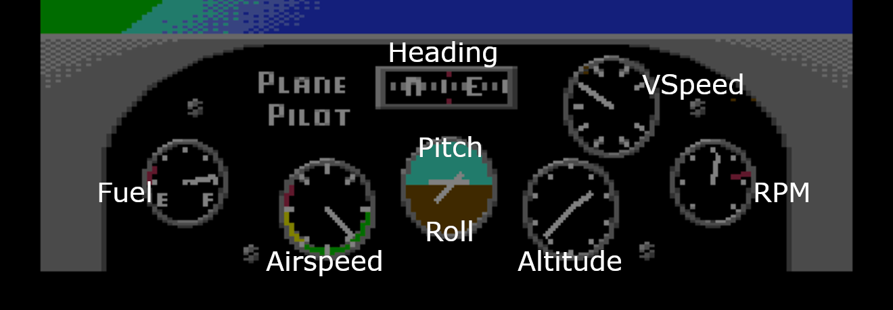

# Plane Pilot & Fighter Pilot

Plane Pilot and Fighter Pilot are 3D flight simulators for the C64.


<video src="https://github.com/user-attachments/assets/b0cbc998-c712-4358-b754-6c445e65b75e" controls="controls" style="max-width: 100%;"></video>

## History and motivation

Plane Pilot and Fighter Pilot show how modern compilers and AI tools can
be used in to create something retro in 2026. It is also an attempt
to push the boundaries of the machine in a somewhat non-typical genre -
3D simulations - something the C64 was absolutely not designed to do.

## Credits

This project would not have been possible without:

- First and foremost, the [oscar64](http://github.com/drmortalwombat/oscar64)
  C cross-compiler from [drmortalwombat](https://github.com/drmortalwombat).
  Make sure to check out his [itch.io](https://drmortalwombat.itch.io/)
  page as well, with many great C64 games!
- Most of the actual testing was done on the VICE emulator.
- Many of the tools and techniques to develop this did not exist back in the 80s.
  Including but not limited to: C was not mature, Python, but even basic things
  like LZO compression.
- While there is a human in charge, and he has even written and optimized a lot
  of the code; the development process has made extensive use of AI coding tools.
  Antigravity and Gemini was involved during early prototyping, and many of the later features were built using Claude Opus 5.

## How to play

There are many online and offline C64 emulators.
One of the easiest: https://ty64.krissz.hu/

Click the web icon and paste the URL:

```
https://github.com/Dornbi/plane-pilot/raw/refs/heads/main/bin/ppilot.prg
```

```
https://github.com/Dornbi/plane-pilot/raw/refs/heads/main/bin/ppilot.prg
```

Alternatively, download the binary and upload it to any of the online or offline emulators:

- [ppilot.prg](bin/ppilot.prg) — the whole game: sound effects, music, the arcade flight model, and the debug view behind `D`
- [fpilot.prg](bin/fpilot.prg) — Fighter Pilot, a combat variant in the making: ten missions against fighters and bombers - some in waves - that hunt you, strafe the airfield and shoot back, with damage that builds up hit by hit; the arcade flight model, and no debug view

Emulators:

- https://c64online.com/ (online)
- https://retrogamecoders.com/c64-emulator/ (online)
- [VICE](https://vice-emu.sourceforge.io/) (offline)

## Features

What you can do in Plane Pilot:

- Select and play from 10 distinct peaceful missions with waypoint objectives
- Interactive main menu and mission selection
- Take off, navigate, land, and taxi on runways
- Dynamic flight model: speed, altitude, pitch/roll/yaw, stall recovery, flap lift/drag, gear drag, and fuel consumption
- SID sound effects: engine roar, stall alarm, touchdown squeal, flap/gear clicks, crash sound effects
- Full-screen map view (`M`) showing the terrain, mission waypoints, aircraft location
- Instrument panel
- Look forward, left, right, and back over the tail
- Maintain almost 10 frames per second on standard C64 hardware

Fighter Pilot is the combat version using the same engine:

- Fly 10 combat missions
- Dogfight enemy fighters
- Shoot at enemy bombers that shoot back
- Cause and sustain damage

What you cannot do:

- No joystick support (keyboard controls only)

Instrument panel:



## Controls

To fly the plane you can use the following keys:

| Keys            | Action                                |
| --------------- | ------------------------------------- |
| `I` `J` `K` `L` | Roll and pitch                        |
| `A` `S`         | Yaw                                   |
| `+` `-`         | Throttle up and down                  |
| `F`             | Toggle flaps                          |
| `G`             | Toggle landing gear                   |
| `B`             | Wheel brakes (on ground)              |
| `Space`         | Fire (Fighter pilot only)             |
| `1` `2` `3` `4` | Look left, forward, right, back       |
| `N`             | Toggle Nav point 1 / 2 (runways)      |
| `M`             | Toggle map view                       |
| `R`             | Reset to starting state               |
| `P`             | Pause / Resume flight                 |
| `T`             | Time compression: 2x / 4x / off       |
| `V`             | Volume: full / low / off (any screen) |
| `D`             | Toggle debug view                     |
| `H`             | Show the help screen                  |
| `Q`             | Quit to menu (fpilot: debrief first)  |

The help screen (`H`) is also available from the main menu.

## Development

See [docs/development.md](docs/development.md) for more details.

## Updates

### 2026-11-14

Fighter Pilot (`fpilot.prg`), new:

- 10 combat missions, with guns and ammo.
- Enemy fighters and bombers, drawn as filled 3D aircraft.
- Opponent AI for fighters to hunt the players and bombers to shoot from the rear.
- Player can have damage when being hit.
- Sounds for the guns and for being hit.
- Debrief screen.
- No debug view, which frees the RAM for all of the above.

Plane Pilot (`ppilot.prg`):

- Each mission has a colour scheme for the sky, ground, clouds and map view:
  Earth, Desert, Dusk or Night.

Both games:

- Time compression on `T`: 2x, 4x, off.
- Landing and coming to a halt refuels.
- Rearranged and redrawn instrument panels.
- Bugfix: a race in the sprite double buffer made the clouds flicker.
- Faster rendering and a lot of free RAM from many optimisation passes.

### 2026-09-12

- A fourth view, `4`: over the tail, 180 degrees from the nose.
- The back view shows the vertical stabilizer.

### 2026-08-30

- Bugfix: Waypoint matching check and made it work for every copy of the world.
- Bugfix: Fixed Crop Duster margins to make it flyable.
- Bugfix: Added altitude limit for the Airshow pass.
- Bugfix: Increased margin for the Fuel Challenge mission.

### 2026-08-29

- Updated counters on the debug screen.
- Optimized the flight model.

### 2026-08-07

- Missions & Objectives: Added 10 playable missions.
- Engine sound.
- Updated flight physics: takeoff roll, touchdown flare, rollout, flaps, gear, etc.
- Map View: Full-screen map view .
- Messages: On-screen messages.
- Added host tests.

### 2026-07-05

- Added support for polygons: runway, lakes
- There is a 32x16 basic map now (map view coming)
- Added support for side views (left and right)
- Many optimizations and bug fixes

### 2026-04-30

- First release.

## Inspirations

- **Stunt Car Racer** is one of the best 3D games for C64, released in 1989 - served
  as a motivation to create a playable, fast 3D game([YouTube](https://www.youtube.com/watch?v=KMgjmIW8fd8)).
- **Spitfire 40** is a flight sim from 1985 with an unplayably low frame rate - served as
  extra motivation to make it fast ([YouTube](https://www.youtube.com/watch?v=cpq0VzBINno)).
- **Chuck Yeager's Air Combat** is a much more advanced flight sim for DOS/PC from 1991,
  served as an inspiration for the horizon rendering and other features ([YouTube](https://www.youtube.com/watch?v=L1x7229289w)).

## License

Plane Pilot is free software: you can redistribute it and/or modify it under
the terms of the GNU General Public License as published by the Free Software
Foundation, either version 3 of the License, or (at your option) any later
version.

This program is distributed in the hope that it will be useful, but WITHOUT ANY
WARRANTY; without even the implied warranty of MERCHANTABILITY or FITNESS FOR A
PARTICULAR PURPOSE. See the GNU General Public License for more details.

You should have received a copy of the GNU General Public License along with
this program. If not, see <https://www.gnu.org/licenses/>.

Copyright (C) 2026 Peter Dornbach. The full text is in [LICENSE](LICENSE).
