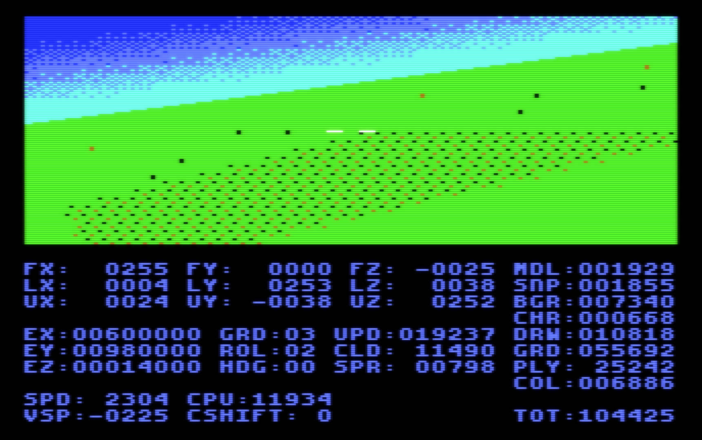

# Development Guide

## Compiling the C64 code

The C64 code in [c64o/](../c64o) is written in C with a few C++ features (`.cc` extension) and targeted 6502 `__asm` in hot paths. Building requires the [oscar64](https://github.com/drmortalwombat/oscar64) cross-compiler and `make` (adjust `OSCAR64_INCLUDE` in [c64o/Makefile](../c64o/Makefile) if needed):

```bash
make prg
```

This builds six programs into `c64o/` (and runs the host and target tests):

| Binary | Description |
| --- | --- |
| `ppilot.prg` | Plane Pilot: 10 peaceful missions, colour schemes, sound, music, arcade flight model, and the `D` debug view. |
| `fpilot.prg` | Fighter Pilot: built from `ppilot.cc` with `-D__FPILOT__` (`fmission.cc`, `opponent*`, `planes*`, `gun*`, `damage.cc`, `debrief.cc`, `fpanel`); no debug view and no colour schemes. |
| `polydemo.prg` | Filled-polygon renderer prototype. |
| `vecdemo.prg` | Character-mode ground-dot prototype. |
| `vectest.prg` | 3D vector correctness and cycle benchmark. |
| `planedemo.prg` | Standalone 3D opponent-sprite renderer demo (`planedemo_prof.prg` adds per-step timing). |

### Build flags

Feature dials let you measure what each subsystem costs or switch flight models:

```bash
make prg FLIGHT_AOA=1              # build ppilot and fpilot with the AoA flight model (flight.md §9)
make -C c64o SOUND=                # omit sound effects and title music
make -C c64o DEBUG=                # omit debug view and CIA2 benchmark counters (ppilot only)
make -C c64o CLOUDS=               # omit clouds
make -C c64o COLOR_SCHEMES=        # omit per-mission colour schemes (ppilot only)
```

Passing `-D__NO_OPPONENT__` in `fpilot` leaves opponents out. Every `ppilot`/`fpilot`/`polydemo` link automatically runs five post-link checks (`check_zeropage.py`, `check_irq_zp.py`, `check_mul_div.py`, `check_rom_window.py`, `check_boot_region.py`).

## Releasing binaries

`c64o/*.prg` files are gitignored build outputs; [bin/](../bin) holds the checked-in binaries linked from [README.md](../README.md):

```bash
make release
```

This runs `make prg` and publishes the five release binaries (`ppilot`, `fpilot`, `polydemo`, `vecdemo`, `vectest`) into `bin/`, reporting which ones changed.

## Running in an emulator & benchmarking

Headless `x64sc` (VICE) drives on-target tests, deterministic screenshots, and cycle benchmarks:

- `tools/vice_shot.sh` / `tools/make_shots.sh` — capture 15 CRT screenshots in `screens/` (`make shots`).
- `tools/vice_dump.sh` — halt on an instruction and read globals from C64 RAM.
- `tools/bench.sh` — measure exact cycle counts across 10 `fpilot` scenes.
- `tools/ram_loop.sh` — unattended RAM/cycle optimisation loop backed by [ram-loop.md](ram-loop.md).

See [emulator.md](emulator.md) for setup and [framerate.md](framerate.md) for current cycle figures.

## Debug view (`D`, Plane Pilot only)

Pressing `D` replaces the instrument panel with live state and CIA2 cycle counters.

**Left side (aircraft state):** `FX FY FZ` (front), `LX LY LZ` (left), `UX UY UZ` (up), `EX EY EZ` (eye position), plus `ROL`, `HDG`, `CPU`, `CSHIFT`, `SPD`, `VSP`.

**Right side (cycle counters, in execution order):**

| Label | Measures |
| --- | --- |
| `MDL` | Flight model step (`flight_advance`) |
| `SNP` | Snap horizon centre to screen coordinates |
| `BGR` | Fill sky/ground background without horizon gradient |
| `CHR` | Copy active `boxdef` characters to char RAM (`box_prepare`) |
| `DRW` | Draw horizon gradient tiles |
| `GRD` | Terrain grid dots and 3D polygons (`PLY` below it is the `poly_draw_3d` subset) |
| `COL` | Copy colour RAM during buffer swap |
| `UPD` | Camera, roll state, cloud scan (`CLD`), sprite stack commit (`SPR`) |
| `TOT` | Sum of the eight top-level stages (`MDL`..`UPD`) |

Notes:
- `PLY`, `CLD`, and `SPR` are breakdowns of `GRD` and `UPD`, not added to `TOT`.
- Key scan, panel updates, `sound_update()`, and the vsync flip wait are outside `TOT`.
- `bm_total()` prints before `mem_switch_buffer()`, so the `COL` inside `TOT` is from the previous frame.
- All counters print five digits (wrapping above 99,999). On a frozen pose `CHR` stays ~400 cycles because `box_prepare()` returns early; while rolling it runs ~10,000–15,000 cycles.



## Python tools and `Makefile` targets

Python library modules live in [lib/](../lib) and CLI scripts in [tools/](../tools). Prefer the root [Makefile](../Makefile) targets so canonical generator flags are preserved:

| Target | Script(s) & output |
| --- | --- |
| `make data` | Runs `chardefs`, `gfx-chars`, `sprites`, `clouds`, `map-tiles`, `music` |
| `make chardefs` | `tools/generate_all.py` → `lib/{chardefs,boxdefs}.py`, `c64o/{chardefs,boxdefs}.{h,cc}`, `reference_frames/` |
| `make gfx-chars` | `tools/generate_gfx_chars.py` → `c64o/gfx_chars.bin` |
| `make sprites` | `tools/generate_sprites.py` → `c64o/{spritedef,titledef}.*`, `lib/{spritedef,titledef}.py` |
| `make clouds` | `tools/generate_clouds.py` → `c64o/clouddef.{h,cc}`, `lib/clouddef.py` ([clouds.md](clouds.md) §7) |
| `make map-tiles` | `tools/generate_map_tiles.py` → `c64o/mapdefs.{h,cc}` from `gfx/ppilot_map_tiles.png` ([map.md](map.md)) |
| `make panel` | `ppanel` + `fpanel` via `tools/png2koa.py` → `c64o/{p,f}panel.{koa,*_lzo}` (pins 5 lamp cells and heading/ammo slots) |
| `make music` | `tools/generate_music.py` → `c64o/musicdef.{h,cc}` and [sid-intro-theme.html](sid-intro-theme.html) ([music.md](music.md)) |
| `make planes` | `tools/generate_planes.py` → `c64o/planedef.h` from `lib/planes.py` ([planes.md](planes.md)) |
| `make map-preview` | `tools/render_map_preview.py` → `out/map_preview.png` |
| `make cloud-preview` | `tools/render_cloud_preview.py` → `out/cloud_preview.png` + density/slot report |
| `make render` | `tools/render_all.py` → `out/rendered_frames/` (all roll angles) |
| `make demo` | `tools/flight_demo.py` — interactive roll/pitch preview (`pygame`) |
| `make pram` / `make fram` | `tools/analyze_ram.py` on `c64o/ppilot.map` / `c64o/fpilot.map` ([memory_map.md](memory_map.md)) |
| `make test` | Python test suite (`python3 -m unittest discover -s tests`) |

Helper scripts also include `tools/generate_frame.py`, `tools/render_frame.py`, and `tools/make_map_tiles_draft.py` (refuses to overwrite `gfx/ppilot_map_tiles.png` without `--force`). Generated previews go to gitignored `out/`.

### Python dependencies

Plain Python 3 (`unittest` is in the standard library) plus:

- `pillow` — required by PNG generators/renderers and tests
- `pygame` — `make demo` only
- `pytest` — optional alternative runner

## Testing

```bash
make test                               # Python unit tests (tests/)
make -C c64o test                       # all 16 C++ host suites + narrowing check + target_test
make -C c64o/test test-both             # run host suites for both arcade and FLIGHT_AOA=1
make -C c64o/test target-test           # on-target 6510 suite in VICE only
make -C c64o/test TARGET_TEST= test     # host suites without VICE
make -C c64o/test narrowing-update      # update narrowing baseline after review
```

The 16 host C++ suites in [c64o/test/](../c64o/test) compile the real `.cc` files under `g++` (mocking hardware registers via `vic.h`, `sid.h`, `mem.h`): `flight_test`, `msg_test`, `map_test`, `sound_test`, `music_test`, `mul_test`, `sprites_test`, `cpu_test`, `poly_test`, `planes_test`, `planes_edge_test`, `opponent_test`, `gun_test`, `fpilot_test`, `mission_test`, and `asm_c_test`.

### The 16-bit `int` trap

oscar64's `int` is **16 bits** while the host's is **32 bits**. C promotes narrower operands to `int`, so intermediate expressions can wrap on the 6510 without wrapping under `g++`:

| Expression | Host (32-bit `int`) | C64 (16-bit `int`) |
| --- | ---: | ---: |
| `(sx + 2) >> 2`, `sx = 32767` | `8192` | **`-8192`** |
| `a * b`, `a = b = 300` | `24464` | `24464` |
| `(int16_t)(-cy) << 8 >> 8`, `cy = -128` | `128` | **`-128`** |

Two defences cover this:
1. [c64o/test/int16.h](../c64o/test/int16.h) provides `i16()`/`u16()` for explicit host truncation, and `make -C c64o/test narrowing` ratchets implicit narrowings against `narrowing.baseline` (or `narrowing-aoa.baseline`).
2. [c64o/test/target_test.cc](../c64o/test/target_test.cc) compiles with oscar64 and executes on the real 6510 in `x64sc` via `tools/run_target_test.sh` (automatically skipped if `oscar64` or `x64sc` is absent).

See [project.md](project.md) for engine architecture and [memory_map.md](memory_map.md) for the full 64 KB layout.
